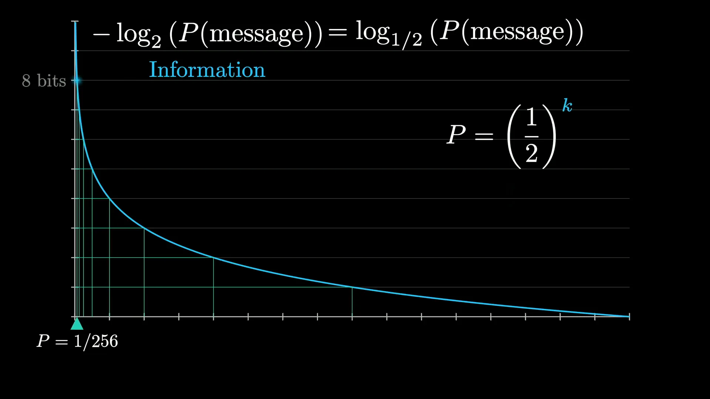
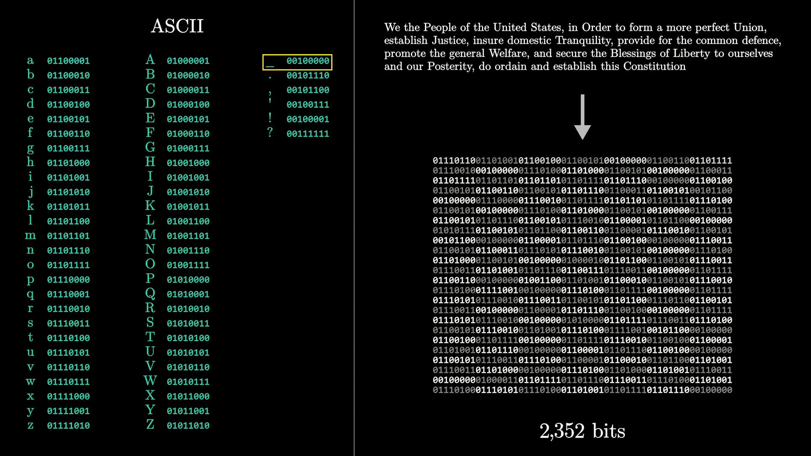
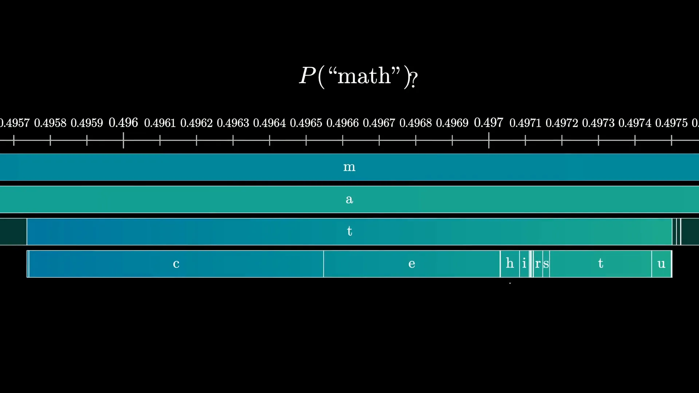
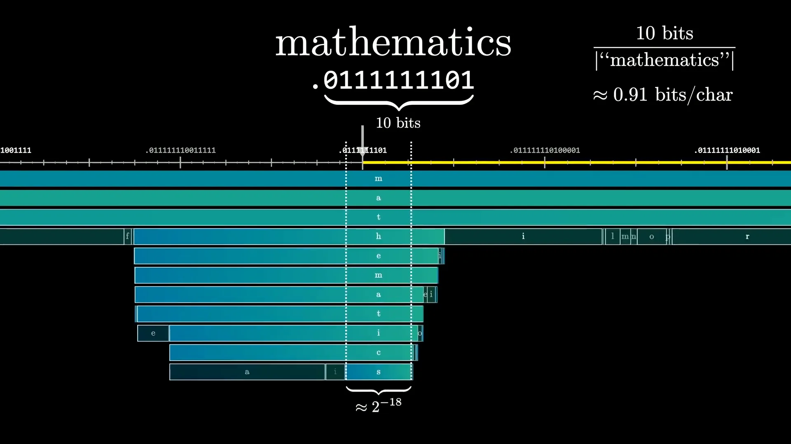
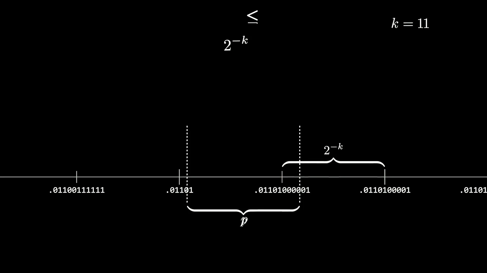
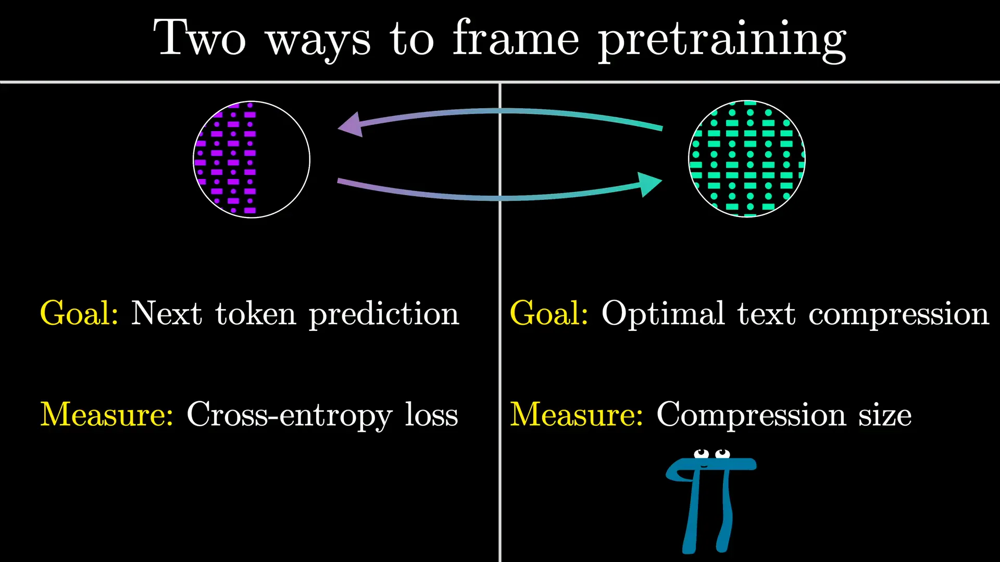
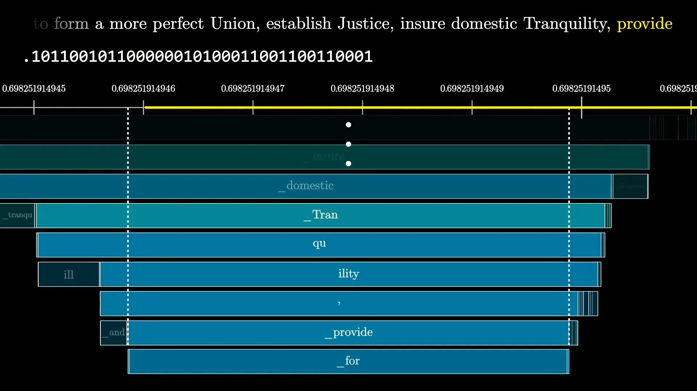
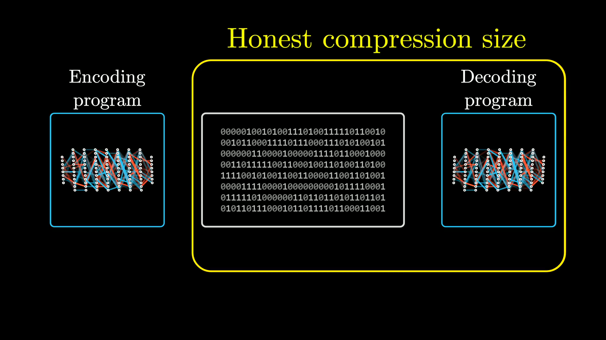
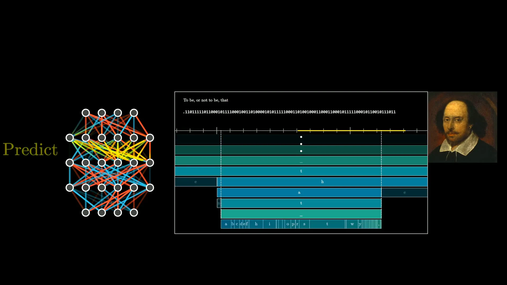

- 原视频（3Blue1Brown）：<https://www.youtube.com/watch?v=qbsb9DpdZ6s>（*This algorithm changed how I think about compression | Information theory, part 3*，2026-11-17）
- 关联知识节点：[信息熵](/graph/) · [交叉熵](/graph/)

---

Hutter Prize（哈特奖）悬赏能把 1 GB 维基百科无损压得更小的方案，且把**压缩比特流**和**解码程序体积**算在一起。历届所有获奖方案的核心，都是同一个算法：**算术编码（Arithmetic Coding）**。

## 一、为什么 `−log₂ p` 听起来很荒谬？

香农在 1940 年代证明，一条消息在最优压缩下的比特数约等于 `−log₂ p`，即它出现概率的负对数。换一种更好懂的写法是 `log₁/₂ p`：**概率每砍半一次，信息量增加 1 bit**；概率为 `(1/2)^k` 的消息，恰好携带 `k` 比特信息。



定性上看很直观：越常见越短，越罕见越长。但落到具体文本上，这个结论听起来近乎荒谬。

以美国宪法序言为例，听完开头 *"We the People of the United States..."*，熟悉它的人几乎能背出后面整段话。就算只给后面原文 50% 的概率，香农信息量也只有 **1 bit**；哪怕保守给到千分之一，也不过 **10 bit**。可传统编码完全摸不到这个边：ASCII 定长编码每个字符占 8 bit，整段要花两千多比特（图示部分为 2,352 bits）；按字母频率分配变长码的霍夫曼编码，也要消耗约 1,500 bits。



把大半段话塞进 10 个比特，这怎么可能？症结在于：霍夫曼编码把每个字符（或固定词块）映射成一成不变的比特串，**完全没有利用上下文**。可预测性高度依赖前文，而我们手里正好有根据上文预测下一个词元的工具——语言模型。剩下的问题很明确：**怎么把一个输出概率分布的预测器，变成真正的无损压缩器？**

## 二、把文本变成 `[0, 1]` 里的一个实数

算术编码的思路非常反直觉，却又干净得惊人：**不再给单个字符分配 0/1 码，而是把整段文本映射成数轴 `[0, 1]` 里的一个实数**，再把这个实数写成二进制发给对方。通信的前提只有一条：发送方和接收方各自装一份**完全一致的语言模型**。模型就像一本共同的「地图册」——编码端拿它把文本一步步定位到数轴上，解码端拿它按图索骥反查回原文。算术编码本身只是通用外壳，模型预测得越准，压出来的比特流就越短。为了看清每一步怎么运作，先假设一个只输出 26 个小写字母的字符级模型（实际换成大模型的词表完全同理）。整个算法分成三步。

### 1. 单位区间 `[0, 1]` 的逐层嵌套：如何编解码？

**第一步：把概率排在 `[0, 1]` 上。** 从空上下文开始，模型会给出首字母的概率分布，所有字母的概率加起来正好是 `1`。把它们按字母顺序首尾相接排在数轴 `[0, 1]` 上，每个字母就分到了一段宽度等于其概率的子区间——常见字母（如 `t` 占 `0.16`、`a` 占 `0.13`）宽敞得多，冷门字母（如 `q`）只剩一条细缝。

![首字母概率分布平铺在 [0, 1] 单位区间上，每个字母占据的宽度等于它的出现概率，总宽度为 1。](../img/doc/ac-unit-interval.webp)

**第二步：按上下文逐层切分。** 现在要编码单词 `"math"`：

1. 首字母是 `m`，选定 `m` 的区间（宽度为 `P(m) ≈ 0.04`，落在 `0.484` 到 `0.523` 之间）。
2. 把 `"m"` 喂给模型，得到第二个字母的条件概率分布（元音占大头，`a` 约 38%，`e` 约 16%）。把整张分布按比例**缩进 `m` 的区间里**，选出 `a`。此时区间宽度变成 `P(m) × P(a | m)`，恰好就是开头为 `"ma"` 的概率。
3. 继续把 `"ma"` 喂给模型，在 `a` 的区间里切出 `t`；再把 `"mat"` 喂给模型，在 `t` 的区间里切出 `h`。



四次连乘下来，由概率链式法则，最终落定的窄区间宽度**正好等于模型给整个词打出的联合概率**：

```text
最终区间宽度 = P(m) × P(a | m) × P(t | ma) × P(h | mat) = P("math")
```

**怎么解码？** 只要把上面的过程逆向重放一遍。编码方在 `"math"` 的最终区间里**随便挑一个实数**（比如 `0.4970580`），连同消息长度 `4`（或者在词表里约定一个结束符 EOF）一起发出去。接收方用同一份模型一步步反查：

1. 给模型喂空上下文，画出第一层 `[0, 1]` 划分，看 `0.4970580` 落在 `m` 的范围里 → 确定第 1 个字母是 `m`；
2. 把 `"m"` 喂给模型，在 `m` 内部画出第二层划分，看 `0.4970580` 落在 `a` 里 → 确定第 2 个字母是 `a`；
3. 依次把 `"ma"`、`"mat"` 喂给模型，凑满 4 个字母，无损还原出 `"math"`。

因为收发两端用着同一份模型、同一套切分顺序，只要发过来的数落进了目标区间，解码路径就绝对唯一。这里还有一个很漂亮的副产品：如果你在 `[0, 1]` 上**均匀随机**戳一个点，按这套解码流程展开，得到的往往不是乱码，而是读起来像模像样的英文片段——因为模型认为越合理的句子，在数轴上占的宽度越大。这既呼应了香农「最优压缩结果应与随机噪声无异」的直觉，也恰好画出了语言模型采样生成文本的几何图像。

### 2. 把实数变成比特流：二进制小数与 `"mathematics"`

网络里只能传 `0` 和 `1`，所以得把挑出来的实数写成**二进制小数**。原理和十进制小数一样，只是把「十等分」换成「反复对半切」：

- 小数点后第 1 位：`.0` 选左半 `[0, 0.5)`，`.1` 选右半 `[0.5, 1)`；
- 第 2 位把刚才选中的那一半再对半切（例如 `.01 = 1/4 = 0.25`，`.11 = 3/4 = 0.75`）；
- 每往后多写 1 bit，候选范围就缩小一半；写完停下来，对应的就是那个精确刻度点。

于是，**编码问题彻底简化为：在目标区间里，找一个二进制写法尽量短的刻度，把小数点后的 0/1 串发出去。**

回到 `"math"`：9 位二进制刻度还太粗，离目标区间最近的左右两个 9 位刻度都落在了外面；加到第 10 位，刻度 `.0111111101` 刚好踩进 `"math"` 的区间里。4 个字母花 10 bit，均摊 2.5 bit/字符，看起来还很一般。

但把词拉长成 `"mathematics"`，威力立刻显现：前面 `"math"` 定下来之后，模型对后面的 `e、m、a、t、i、c` 极有把握（每一步概率几乎接近 100%），切分时目标区间**几乎没有缩小**，直到最后一个 `s` 才略微收窄。结果，刚才代表 `"math"` 的**同一个 10 位小数 `.0111111101`，依然稳稳落在 `"mathematics"` 的目标区间里**！（接收方靠附带的消息长度 `4` 还是 `11`，就能区分这两个词。）11 个字母总共只花 10 bit，均摊已经压到了 `0.91 bit/字符`。



### 3. `2⁻ᵏ < p`：保底为什么只需要 `⌈−log₂ p⌉` 比特？

细看上图会发现一个微妙之处：`"mathematics"` 的最终区间宽度其实只有约 `2⁻¹⁸`（理论信息量是 18 bit），而 10 位二进制小数的相邻刻度间距是 `2⁻¹⁰`，宽得多——之所以 10 位就够用，纯粹是这个窄区间**碰巧跨过了一个 10 位刻度**，撞大运了。那不靠运气，**最坏情况下保底需要多少比特**？

数一下二进制刻度尺的密度：2 位小数相邻间隔 `1/4 = 2⁻²`，3 位相邻间隔 `1/8 = 2⁻³`；一般地，所有不超过 `k` 位的二进制小数在数轴上均匀排布，相邻刻度间距正好是 **`2⁻ᵏ`**。现在有一段宽度为 `p` 的目标区间。不管它藏在数轴多刁钻的位置，只要刻度间距比区间宽度更小，这段区间就不可能从两个相邻刻度的缝隙里溜走——**必然至少压住一个 `k` 位刻度**：

```text
2⁻ᵏ < p   ⇔   −k < log₂ p   ⇔   k > −log₂ p
```



换句话说，对 `−log₂ p` 向上取整（`⌈−log₂ p⌉`），就是**保证**能唯一标定这段文本的比特数；碰巧压中更粗的刻度时，还能更少。顺带补齐两个常见疑问：

- **额外传的消息长度会拖后腿吗？** 几乎不会。固定一个 32 bit 文件头就能表示长达 40 亿字符的文本，长消息里摊到每个字几乎为零。
- **像 `"mathematics"` 这样 10 bit < 18 bit，算打破香农极限吗？** 不算。更极端的情况，全由 `a` 组成的字符串一直贴在左端点 `0` 上，甚至只需要空比特串。但香农定理限制的是**平均长度**——少数撞大运省下来的比特，会被绝大多数时候不得不向上取整多花的比特抵消掉。

## 三、预训练交叉熵 = 算术编码压缩长度

真正拉开与香农极限距离的，是公式里的 `p` 代表**模型的预测概率**，而非语言的真实分布。把联合概率按链式法则展开，对数里的乘积变成求和：

```text
−log₂ P(x₁…xₙ) = Σₜ −log₂ P(xₜ | x<ₜ)
```

每一项都是模型预测下一个词元的比特开销：猜得准趋近 0，猜错了代价暴涨。这项开销在训练语料上的平均值，正是语言模型预训练最小化的**交叉熵损失**。于是预训练有了两种数学等价、直觉却迥异的视角：

- **预测视角**：训练一个下一词元预测器，交叉熵只是选出来的一个损失函数。
- **压缩视角**：直接训练一个**最强的文本压缩器**，优化目标再直白不过——让每条训练样本压出来的比特数尽可能小。



换用更强的模型，压缩率肉眼可见地跳变。同一句关于古希腊数学与欧几里得《几何原本》的句子，370 万参数的 **NanoGPT** 需要 254 bits（约 2 bits/字符）；换成 5 亿参数的 **Qwen**，整体降到 **1 bit/字符以下**，末尾 *"Euclid's Elements"* 两个词只花了 5 bits。

回到开篇的美国宪法序言：用 Qwen（词元粒度）编码，开头 *"We the People of the United States..."* 消耗约 35 bits，而**后面整段正文总共只多花了 10 bits**——比霍夫曼少了两个数量级。后续词元几乎占满每一步概率条，这 10 bits 大多只是用来确认大小写和拼写变体（如 `defence` 用 `c` 还是 `s`）。



> **工程落地**：照字面存超高精度实数很快会精度溢出。这个构想最早由 Peter Elias 在 1960 年提出，1976 年 Jorma Rissanen 与 Richard Pascoe 独立引入**重归一化（renormalization）**——每步把工作区间重新放大回单位宽度——才成为实用的**算术编码**。2013 年 Jarek Duda 提出的 **非对称数制（ANS）** 则改用不断增长的整数编码，避开了实数精度问题，速度更快。

## 四、重新审视「压缩即智能」

最后回到标题：**压缩即智能**。「智能」是个含混的日常概念。视频建议像看待牛顿定义「能量」（`kg·(m/s)²`）那样看待这句话：数学定义必然是片面的，装不下日常语言里的所有细微含义；但只要它**有生产力**，能把原本分散的现象统一进同一套框架，就值得认真对待。借着算术编码，压缩至少抓住了智能的三个侧面：

### 1. 压缩与预测等价

算术编码把任意预测器变成压缩器；反过来，任意黑盒压缩器也能变成预测器——把候选词拼在原文后面再压一次，看体积多出 `δ` 比特，`2^(-δ)` 就是它隐含的条件概率估计。预测离不开对背后规律的建模，这也呼应了神经科学里的**预测加工（Predictive Processing）**假说：大脑持续自上而下预测感官输入，感官只向上传递「预测与现实的误差」。

### 2. 诚实的压缩账单

单靠「预测」还漏掉了一种重要的理解：我们觉得懂了一件事，往往是因为它在脑子里**变小了**——我们可以用极少原理推导出大片事实。
用几亿参数的 Qwen 把宪法序言压成 10 bits 之所以像作弊，是因为模型早把它背进了权重里。所以必须算**诚实账单（Honest compression size）**：像 Hutter Prize 那样，把**压缩比特流 + 解码程序（含模型权重）**合并计总（否则把整部维基百科硬写进解码器就能把载荷压成 0）。



在这套账本下，两个预测能力相同的模型，**参数更小的那个才是更好的压缩器**——它靠的是通用规律而非死记硬背。这正是「压缩即智能」比「预测即智能」更深刻的地方。

### 3. 边压边学，把学习速度也装进压缩率

聪明人进入陌生领域学得极快。静态模型的压缩率看似和训练速度无关，但只要加一个小改动：拿维基百科训练的模型去压莎士比亚全集时，不冻结参数，而是**边压边微调**——每读一个词元就做一次确定性的反向传播更新权重。解码端同步重放完全一致的更新，两端预测分布依然严丝合缝。甚至可以从同一个伪随机种子起步，连预训练权重都省掉。此时，**模型适应新语境越快，最终压出来的比特流就越短**。



---

译者：

当我们把 3BlueBrown 的 **压缩即智能** 三部曲串起来看：第一期，香农想研究压缩却被迫调查人类的预测能力；第二期，现代 AI 工程运转在为压缩发明的数学工具上；第三期，想造出最强的压缩器，我们就需要一个**预测准、体积小、学得快**的模型。

压缩当然不等同于全部人类智能，就像 `kg·(m/s)²` 装不下词典里「Energy」的全部含义。但把「让文件变小」这个朴素目标推到足够的深度，这个过程中竟能把预测、简约抽象与快速学习这几件事相关关联起来。

3BlueBorwn 的系列视频我都十分喜欢，我目前还是觉得个人的表述能力和思考深度不足以支撑我写出优秀的内容，所以选择这种方式去转述我喜欢的视频核心内容。补充一点，上文中所有图片都来自 3BlueBorwn 的视频。这篇处理过程中我借助了 gemini-4-neon 的写作能力，在它写出来的内容上我再行修改，哈吉米这代模型语言能力真的很不错，文风相对 gpt 十分自然易懂，感兴趣可以多多尝试！

## 参考

- 3Blue1Brown, *This algorithm changed how I think about compression | Information theory, part 3*：<https://www.youtube.com/watch?v=qbsb9DpdZ6s>
- Hutter Prize（Human Knowledge Compression Contest）：<http://prize.hutter1.net/>
- Nayuki, *Reference arithmetic coding*：<https://www.nayuki.io/page/reference-arithmetic-coding>
- Jarek Duda, *Asymmetric numeral systems (ANS)*：<https://arxiv.org/abs/0902.0271>
