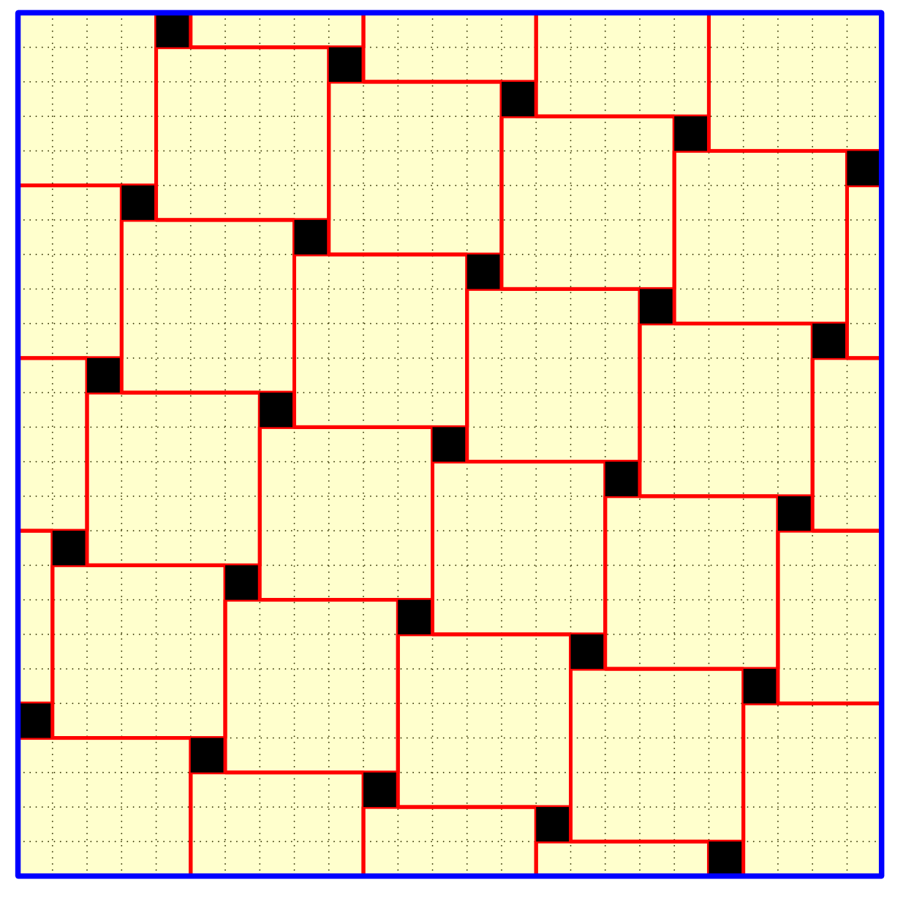
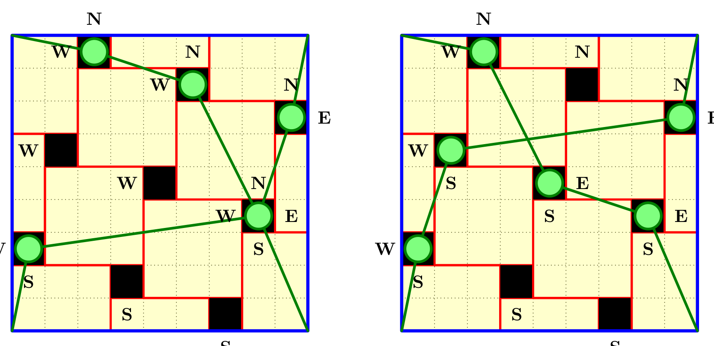
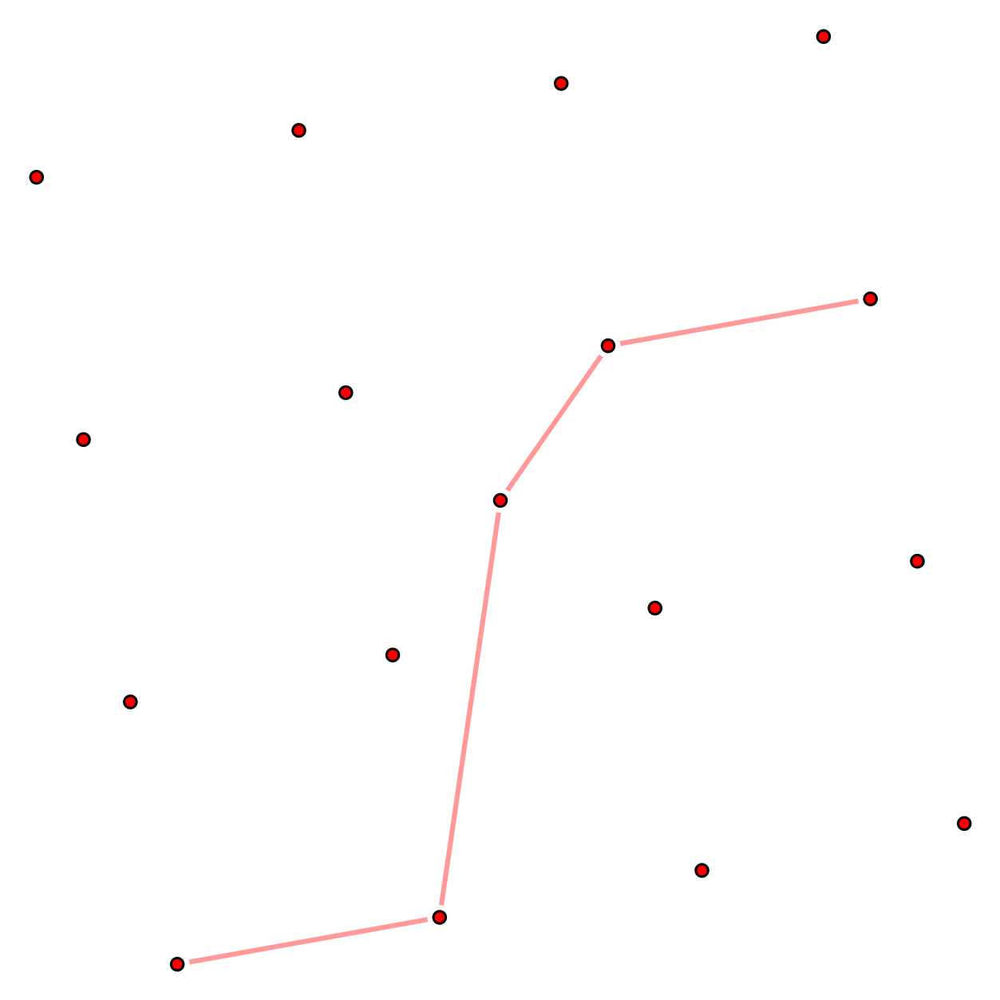

- 视频（B 站，官方双语）：<https://www.bilibili.com/video/BV1znaf61EnS/>
- 原视频（3Blue1Brown）：<https://youtu.be/Nbwv5wHQoj0>
- 发布：2026-10-01

## 题目

IMO 2025 第 6 题，命题人 Zhao Yu Ma 和 David Lin Kewei（新加坡）。

> Consider a 2025 × 2025 grid of unit squares. Matilda wishes to place on the grid some rectangular tiles, possibly of different sizes, such that each side of every tile lies on a grid line and every unit square is covered by at most one tile.
>
> Determine the minimum number of tiles Matilda needs to place so that each row and each column of the grid has exactly one unit square that is not covered by any tile.

中文：

在 2025 × 2025 的单位方格网格里，Matilda 要放入若干矩形瓷砖（大小可以不同），要求每块瓷砖的每条边都落在网格线上，并且每个单位格至多被一块瓷砖覆盖。请确定：当每一行、每一列都恰好有一个单位格没被任何瓷砖覆盖时，她最少需要放多少块瓷砖。

注意，题目要求的不只是一个数字——你还得证明不可能用更少的瓷砖做到。

## 思路

读一份打磨好的证明，你能确认每一步都对，却很难看出这些步骤是怎么想到的。而 3Blue1Brown 的视频恰好做了一件难得的事：他把思路发现的过程还原了出来。借用视频结尾的一句话——也许证明本身都不是最重要的，真正有价值的，是走向证明的那段旅程。

下面我就沿着视频的进度，把每一步"为什么会这么想"记录下来。为了方便，网格边长写成 k²（本题 k = 45）；为什么用完全平方数，第三步就能自然而然看出来。

### 一、引入：切立方体

视频没有一上来就讲题，而是先抛出一个看似毫不相关的问题：

> 把 3×3×3 的立方体切成 27 个单位小方块。每一刀都是一个完整的平面，但每切完一刀，你可以把碎块随意拼在一起再切。最少需要几刀？

不妨先停下来想一想。

答案是 6 刀——三个方向各切两刀。真正有趣的是那个"不能更少"的论证（我们要解决的题目最重要的也是这个论证过程）：注意正中间那个小方块，它的 6 个面原本全部埋在大立方体内部，每个面都需要一刀来切出来；而一刀只是一个平面，不管你怎么重新摆放碎块，一刀至多暴露它的一个面。所以 6 个面必须得切 6 刀。

这个小例子里藏着一种强大的下界策略：**找到一个被"包裹"着的对象，数清它有多少条边界必须由外力切开，再看每一步操作至多能切开几条**。这道铺瓷砖的题，用的正是同一招——被包裹的对象，就是那些空出来的格子的边。

### 二、空格的分布

先观察空格的分布。每行恰好一个，每列恰好一个——这不就是国际象棋里 n 个互不攻击的车吗？给每个空格画个 X，这些 X 的位置其实定义了一个置换。

接下来，把每个 X 的四条边标亮。由于同一行或同一列不会出现两个 X，它们之间不会水平或垂直相邻。于是，一条标亮的边只要不贴在网格外框上，它的另一侧就一定是被某块瓷砖覆盖的格子——换句话说，那条边必定与某块瓷砖接壤。唯一的例外是贴着最外圈的四条边：最上面那行的 X 的上边、最下面的下边、最左列的左边、最右列的右边。

现在换一个视角，站在瓷砖的角度看。一块瓷砖的上边紧邻着同一行的一排格子，而这一行只有一个 X，所以上边最多碰到一个 X 的标亮边；下边同理。左右两边则涉及的是同一列的格子，每列也只有一个 X，各最多碰到一个。四面合计，**一块瓷砖至多能"负责"4 条标亮的边**。

标亮的边一共 4k² 条，去掉贴在外框上的 4 条，还剩 4k² − 4 条需要瓷砖来负责，于是瓷砖至少要 k² − 1 块。

这个下界虽然是对的，但还不够收敛，后面我们来看如何得到一个更小的下界。

### 三、构造：让 X 落在瓷砖的角上

既然下界要求大部分瓷砖四条边各贴一个 X，那 X 贴在边上的什么位置也很关键。想象一个 X 贴在某块瓷砖右边的中段：X 正上方和正下方的格子得由另外的瓷砖来覆盖，这两块瓷砖的左边会顶在原来那块瓷砖上，碰不到任何 X，白白浪费了一条边的"配额"。要想把每条边都用满，**X 应该贴在瓷砖的角上**，四个 X 围着一块瓷砖排成风车形。

什么形状最适合这种风车排布？正方形——它四面对称，而且在周长相同的矩形里面积最大，能覆盖最多的格子。取边长 k 的正方形去铺边长 k² 的网格恰到好处。2025 = 45² 正好是完全平方数，这也解释了为什么一开始要写 k²。

开头那张图展示的就是 k = 5 的情形。数一下块数：中心部分是 (k−1)² 块 k×k 的正方形，四周再补 4(k−1) 块边缘瓷砖，合计

(k−1)² + 4(k−1) = k² + 2k − 3

代入 k = 45，得 2025 + 90 − 3 = **2112**。但这还只是一个构造的上界——我们猜它就是最小值，接下来要证明没有人能用更少的瓷砖做到。

### 四、如果只数一个方向

试着换一种更精细的数法：这次只标亮每个 X 的右边。一块瓷砖的左边紧邻同一列的格子，每列只有一个 X，所以每块瓷砖至多碰到一条标亮的边。k² 条右边扣掉贴外框的 1 条，依旧得到至少 k² − 1 块。

数值没变好，但瓶颈暴露出来了：这个计数只利用了瓷砖的左边，对网格的一侧数得很准，另一侧却完全漏掉了。题目的结构在四个方向上是对称的，我们的计数却只朝一个方向看——偏差自然在所难免。

这就是下一步的路标：**能不能四个方向一起数？**

### 五、分区域，四个方向一起数

思路很清晰：把网格分成四个区域，每个区域里的 X 只标亮朝向外侧的那条边。关键是这四个区域该怎么划分。

视频的做法非常巧妙——从那些 X 的位置（也就是那个置换）里挑出两条路径：一条从左下走到右上，是最长递增子序列（LIS）；一条从左上走到右下，是最长递减子序列（LDS）。这两条路径像两把剪刀，把网格裁成上、下、左、右四片区域。每片区域里的 X 标亮朝外的那条边，路径上的 X 则一举标亮两条。

这样的标亮方案有一个漂亮的性质：每条标亮的边仍然都会碰到某块瓷砖，而每块瓷砖至多只碰到其中一条——不会出现重复计数。最终得到瓷砖数的下界：

k² + LIS + LDS − 3

其中每个 X 至少贡献一条边，路径上的 X 多贡献一条，再扣掉贴外框的边并修正两条路径交点处的重复，最终留下那个 −3。

那么，要达到我们猜测的 k² + 2k − 3，只差最后一步：

LIS + LDS ≥ 2k

### 六、Erdős–Szekeres 收尾

走到这一步，问题已经脱离了网格和瓷砖的语境，变成了一个关于置换本身的纯组合学命题。而这个命题，恰好有两个经典结论可以直接引用：

- **Erdős–Szekeres 定理**：任何长度为 n 的序列，其最长递增子序列长度与最长递减子序列长度的乘积满足 LIS · LDS ≥ n；本题 n = k²。
- **均值不等式**（AM–GM）：(LIS + LDS) / 2 ≥ √(LIS · LDS)。

两者联手：LIS + LDS ≥ 2√(k²) = 2k。下界与构造完美吻合——答案就是 **k² + 2k − 3** 块，k = 45 时即 **2112** 块。

---

回过头来看，整个证明的骨架只有三段：先利用对称性构造出一个候选方案，猜出答案；再用"每条边都必须有人负责"的思想建立下界；最后把下界问题归结为置换的最长单调子序列——一个 Erdős 和 Szekeres 在七十年前就已经解决的问题。

Erdős–Szekeres 定理的证明细节和分区计数的严格推导，有缘再补充。

## 严格证明

完整严格证明见 <https://orply.com/articles/3blue1brown/the-last-imo-problem-ai-could-not-solve-1e8d7d9c>。

## 参考
- Evan Chen, *IMO 2025 Solution Notes*：<https://web.evanchen.cc/exams/IMO-2025-notes.pdf>（文中配图出自此，版权归原作者，此处仅用于说明题目）
- David Eppstein, *Monotone-subseq-17-5.svg*, Wikimedia Commons（公有领域）

